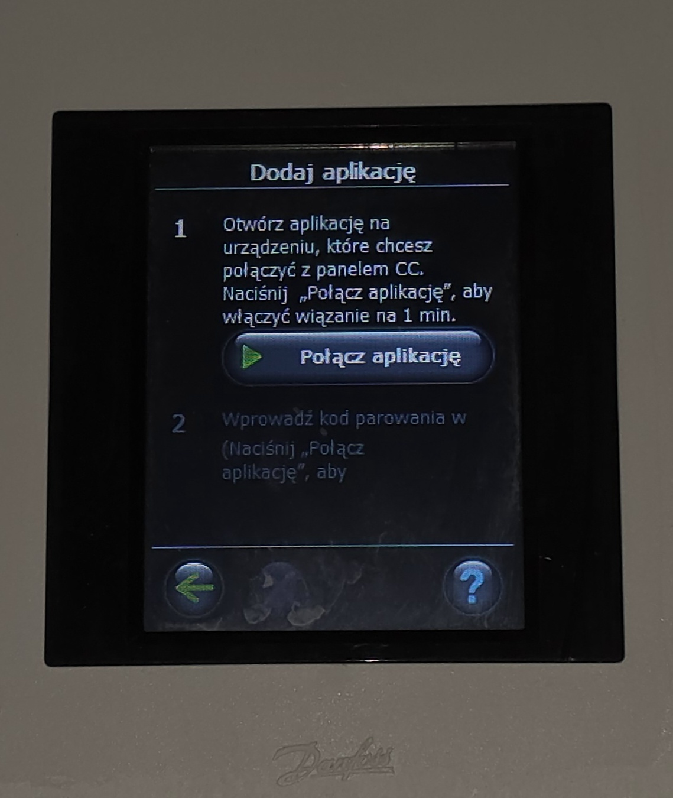
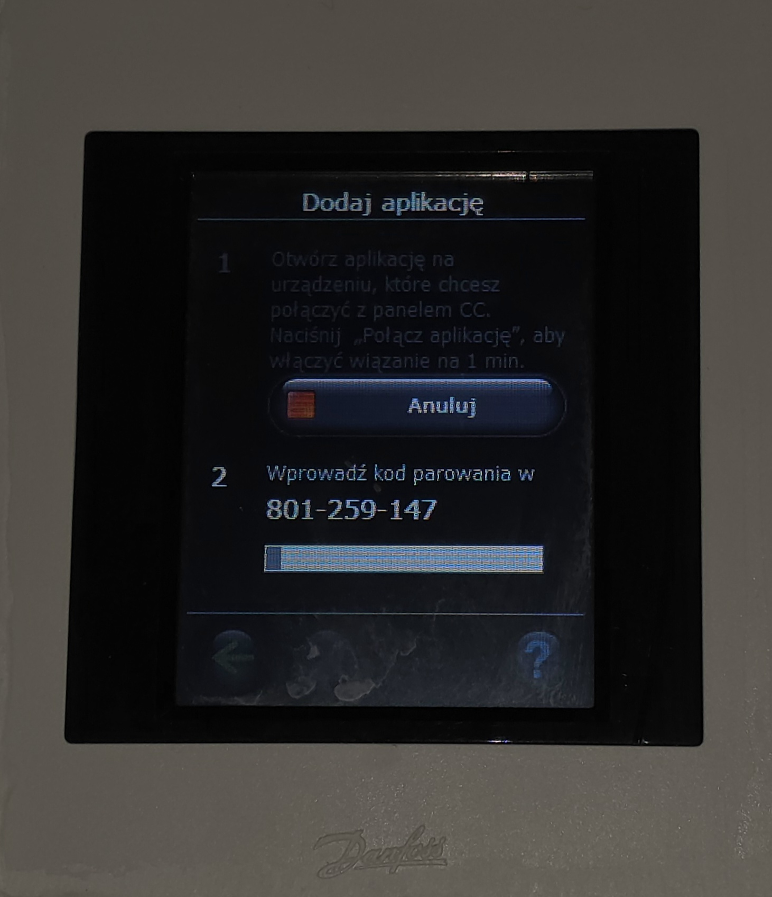
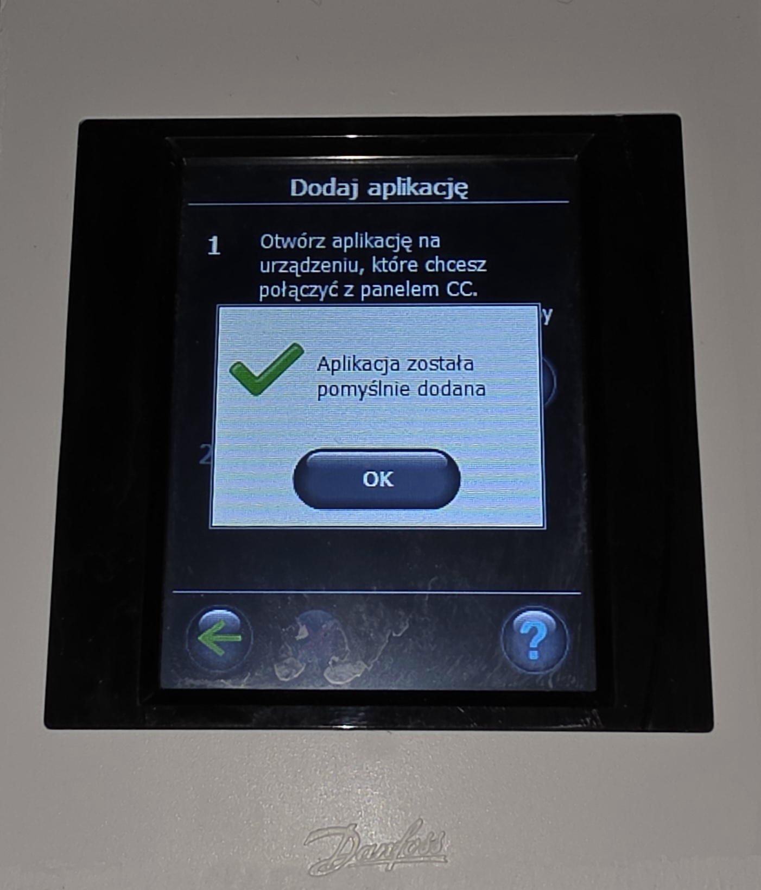
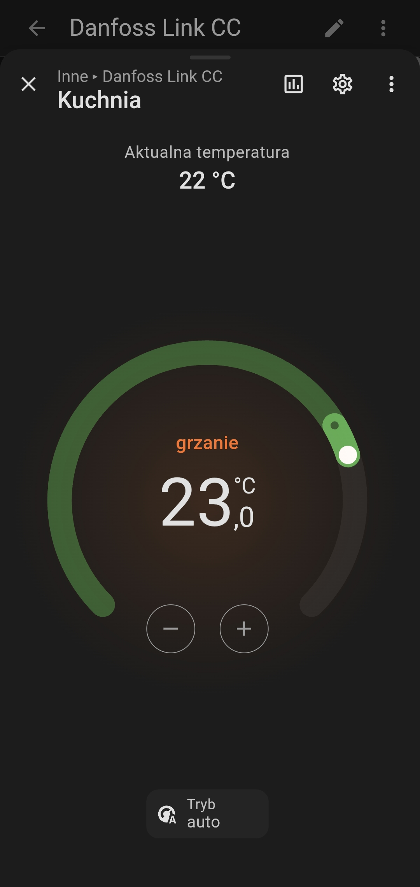
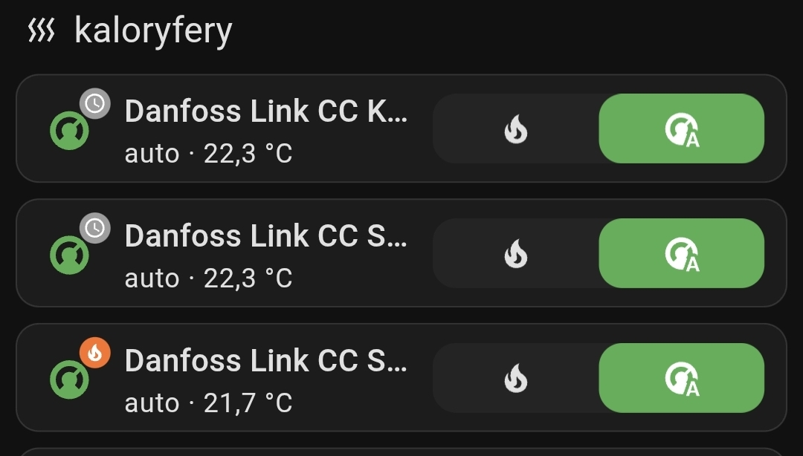

# Danfoss Link CC for Home Assistant

Home Assistant integration for the **Danfoss Link™ CC** touch panel. It talks to the panel
through the cloud relay `mdg-danfoss.hosted.trifork.com`.

> [!NOTE]
> This is an **unofficial** community project and is not affiliated with or endorsed by
> Danfoss or Trifork. The protocol was reverse-engineered for interoperability; see
> [danfoss-link-cc](https://github.com/UrbanskiDawid/danfoss-link-cc) for the details and
> audit trail.

## Entities

| Entity | Content |
|---|---|
| `climate.<room>` (one per room) | Current and target temperature. Set the target temperature. Mode `auto` follows the panel's schedule; `heat` is a manual setpoint. The action shows `heating` or `idle`. |
| State sensor | System state: `AtHome`, `Asleep`, `Away`, ... |
| Alarms sensor | Number of unresolved alarms, with the list in the `alarms` attribute. |
| Battery binary sensor | On while an unresolved alarm relates to a battery. |

The panel is polled once a minute.

## Installation

### HACS

In HACS open ⋮ → *Custom repositories*, add
`https://github.com/UrbanskiDawid/home-assistant-danfoss-link-cc` as an *Integration*,
download **Danfoss Link CC** and restart Home Assistant.

### Manually

Download [`danfoss_link_cc.zip`](https://github.com/UrbanskiDawid/home-assistant-danfoss-link-cc/releases/latest/download/danfoss_link_cc.zip),
unzip it to `config/custom_components/danfoss_link_cc` and restart Home Assistant.

## Configuration

1. On the touch panel, add a new app/device. It shows a 9-digit code.
2. In Home Assistant go to Settings → Devices & services → Add integration →
   **Danfoss Link CC** and enter the code.

| 1. "Dodaj aplikację" (Add app) screen | 2. Pairing code shown | 3. App added |
|---|---|---|
|  |  |  |

## Screenshots

| Single room control | Three rooms at once |
|---|---|
|  |  |

- **Single room control:** one open heat control set to 23 °C, with a dial to change the target temperature.
- **Three rooms at once:** three controls, each showing the name and temperature and allowing the mode to be switched between automatic and manual.

## License

[MIT](LICENSE)
